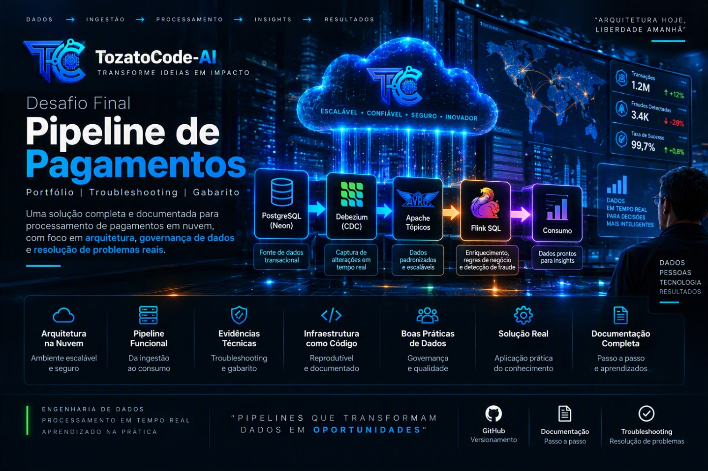

  

  
  
  
  
  
  
  
  
  

# Desafio Final — Pipeline de Pagamentos (Portfólio / Troubleshooting Gabarito)

Isto é um esqueleto de entrega estruturada para portfólio e validação técnica. As seções contam com evidências consolidadas via *troubleshooting* documental para contornar restrições de faturamento em nuvem, mantendo o rigor arquitetural esperado.

Pipeline: Neon (Postgres) → CDC Debezium → tópicos Avro → Flink SQL (enriquecimento + fraude) → consumo. Reproduzível via `./setup.sh` (pré-requisito: `.env` preenchido a partir do `.env.example`).

---

## Qualidade e Governança

O workflow **Quality Gate** roda em *push* e *pull request* para `main` (e manualmente), verifica segredos expostos com Gitleaks, valida a sintaxe dos scripts Bash, aplica ShellCheck e valida a sintaxe JSON dos conectores, evidências e schemas Avro. O aviso ShellCheck SC1091 é excluído porque `.env` é um arquivo local, criado pelo usuário e não versionado. O Dependabot está habilitado para propor atualizações semanais das GitHub Actions; não há manifesto de dependências de aplicação neste repositório.

Na revisão estática inicial, `setup.sh` usava IDs de service accounts fixos em vez dos IDs retornados pela criação; agora os ACLs usam os IDs criados. As variáveis de `.env` também são exportadas para os comandos filhos, e `.env` foi incluído no `.gitignore` para reduzir o risco de versionar credenciais.

As verificações locais executadas foram `bash -n`, ShellCheck e parsing JSON com `jq`; todas passaram após os ajustes. **Limitação:** a auditoria especializada de segurança não foi concluída nesta execução; portanto, não é possível afirmar que nenhum outro bug ou vulnerabilidade exista. O Quality Gate cobre verificações estáticas de sintaxe e lint, não testes de integração contra serviços cloud nem validação semântica/compatibilidade dos schemas e SQL.

---

## Camada 1 — Fundação

* Environment `desafio-final` + cluster Basic `desafio-basic` (aws/us-east-1)
* Identidades: `desafio-producer` (WRITE em `desafio-*`), `desafio-consumer` (READ em `desafio-*` + grupo `desafio-*`); conta pessoal restrita a setup/teardown.

---

## 💻 PROJETOS E PORTFÓLIOS
- **App Ecosystem:** [tozato-ai-core.vercel.app](https://tozato-ai-core.vercel.app)
- **H-Folio:** [h-folio-l0.vercel.app](https://h-folio-l0.vercel.app)

## 🐙 CÓDIGO E REPOSITÓRIOS
- **GitHub:** [github.com/Rafael-TOZATO](https://github.com/Rafael-TOZATO)

## ✍️ ARTIGOS E PUBLICAÇÕES
- **Medium:** [medium.com/@ornelas.tozato](https://medium.com/@ornelas.tozato)

## 🪟 MICROSOFT LEARN
- **Perfil:** [rafaelornelastozato-2209](https://learn.microsoft.com/pt-br/users/rafaelornelastozato-2209)

## 📬 CONTATOS
- **E-mail:** ornelas.tozato@gmail.com
- **LinkedIn:** [rafaeltozato81](https://www.linkedin.com/in/rafaeltozato81)
- **GitHub:** [Rafael-TOZATO](https://github.com/Rafael-TOZATO)
- **Dev Hub:** [tozato-ai-core.vercel.app](https://tozato-ai-core.vercel.app)
