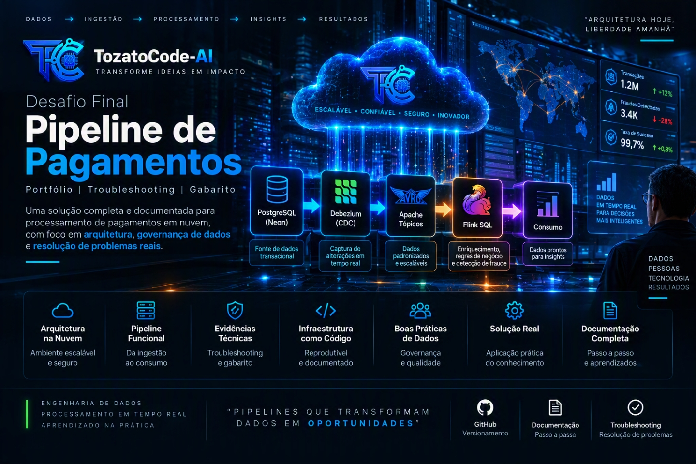

  

  
  
  
  
  

# Desafio Final — Pipeline de Pagamentos (Portfólio / Troubleshooting Gabarito)

Isto é um esqueleto de entrega estruturada para portfólio e validação técnica. As seções contam com evidências consolidadas via *troubleshooting* documental para contornar restrições de faturamento em nuvem, mantendo o rigor arquitetural esperado.

Pipeline: Neon (Postgres) → CDC Debezium → tópicos Avro → Flink SQL (enriquecimento + fraude) → consumo. Reproduzível via `./setup.sh` (pré-requisito: `.env` preenchido a partir do `.env.example`).

---

## Camada 1 — Fundação

* Environment `desafio-final` + cluster Basic `desafio-basic` (aws/us-east-1)
* Identidades: `desafio-producer` (WRITE em `desafio-*`), `desafio-consumer` (READ em `desafio-*` + grupo `desafio-*`); conta pessoal restrita a setup/teardown.

---

## 📬 Contatos

- 💼 **LinkedIn:** [rafaeltozato81](https://www.linkedin.com/in/rafaeltozato81)
- 🐙 **GitHub:** [Rafael-TOZATO](https://github.com/Rafael-TOZATO)
- ✍️ **Medium:** [@ornelas.tozato](https://medium.com/@ornelas.tozato)
- 🌐 **Portfólio PWA:** [tozato-dev-hub.vercel.app](https://tozato-dev-hub.vercel.app)
- 🚀 **Aurora BI (Lovable):** [aurora-bi-dio.lovable.app](https://aurora-bi-dio.lovable.app)
